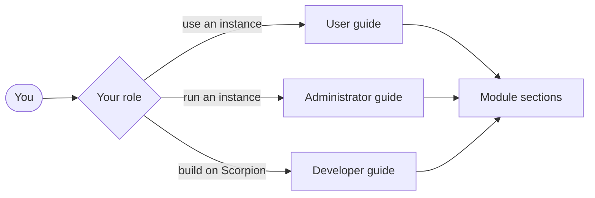

import ModuleBadge from '@components/ModuleBadge.astro';
import Since from '@components/Since.astro';

This knowledge base has three guides, one for each role you can have with a Scorpion instance, plus a terminology section and one section for each optional module.

## Pick your role

- **Users** follow journeys in the [user guide](/user/).
- **Administrators** use the [administrator guide](/admin/).
- **Developers** use the [developer guide](/developer/).
- Everyone can look up words in the [terminology](/terminology/).

## Module badges

A page that needs an optional module shows a badge such as <ModuleBadge id="registry.services" /> under its title. Your instance has the page's behaviour only if that module is in its profile. Core modules are in every profile and have no badge.

## Since and verified markers

The footer of a page shows the first Scorpion release with the behaviour (<Since version="v0.1.0" />) and the release the page was last checked against. This knowledge base documents the release named in `scorpion.json`.

## Draft pages

A page that describes behaviour not yet released is marked as a draft. Drafts are not published, so you only meet them in a local build.
