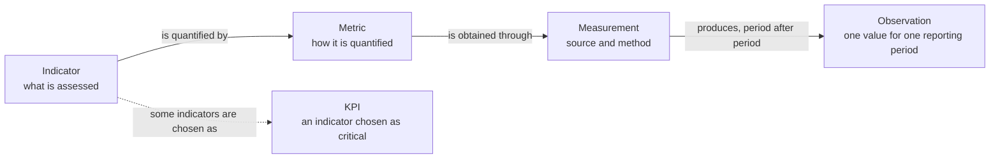
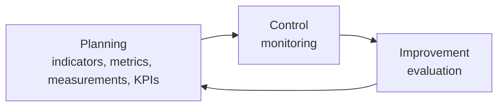

import Term from '@components/Term.astro';

This section defines the terms of monitoring and evaluation for research infrastructures. The definitions do not depend on any tool. The [term map](/start/scorpion-terms/) in the Start here section shows how the names used in a particular tool map to these terms.

Each term has one page with a definition, an explanation, an example, a list of terms it is often confused with and references. Where usage differs between communities, the page says so and states which usage the KB follows. Where a definition is a working definition rather than a community standard, the page says that too.

## Indicator, KPI, metric, measurement: how they relate

Four terms are often mixed up. They answer different questions.

- What is assessed? The <Term id="indicator" />.
- How is it quantified? The <Term id="metric" />.
- Where do the data come from? The <Term id="measurement" />.
- Which indicators matter most? The <Term id="key-performance-indicator" /> (KPI) is an indicator that an organisation selects as critical.

The ELIXIR Impact Toolkit recommends keeping the first three apart. Its example is citation impact. The indicator is "citation impact". The metric is average citations, total citations or the number of highly cited publications. The measurement is the sources that supply the data for the metric. The KB follows this distinction.

An indicator is quantified by a metric. The metric is obtained through measurements. Each measurement run for a <Term id="reporting-period" /> produces an <Term id="observation" />, and the observations over many periods form a <Term id="time-series" />. Some indicators are chosen as KPIs because they matter most for an organisation or a network.

## Monitoring and evaluation

<Term id="monitoring" /> observes services continuously. <Term id="evaluation" /> interprets the record at intervals. In a quality cycle they correspond to control and improvement. Planning fixes the indicators, their metrics and measurements and the subset chosen as KPIs. In a federation of providers, planning takes the form of <Term id="kpi-harmonisation" /> and <Term id="kpi-standardisation" />, and monitoring takes the form of <Term id="federated-monitoring" />.

